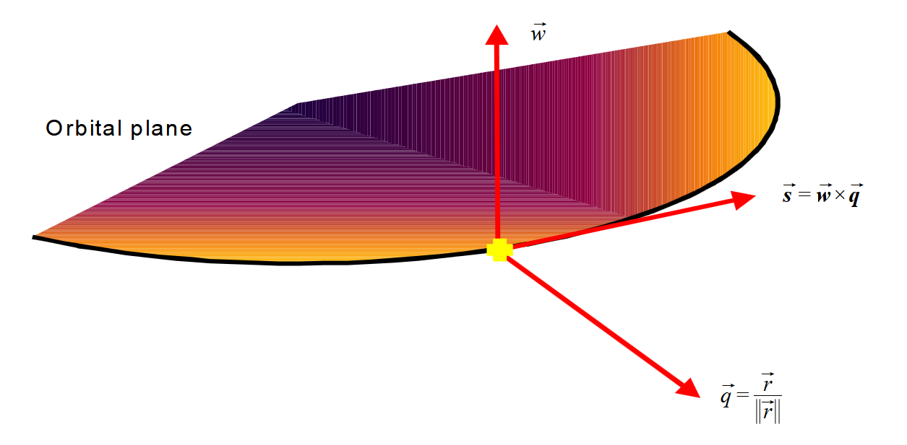
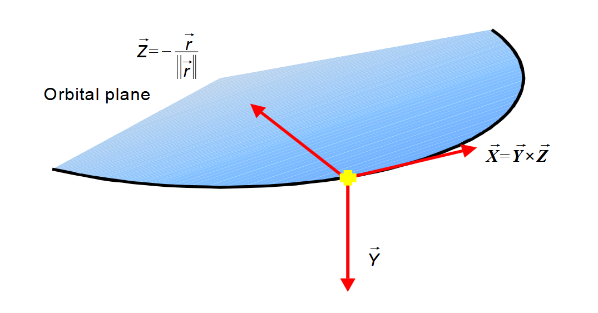
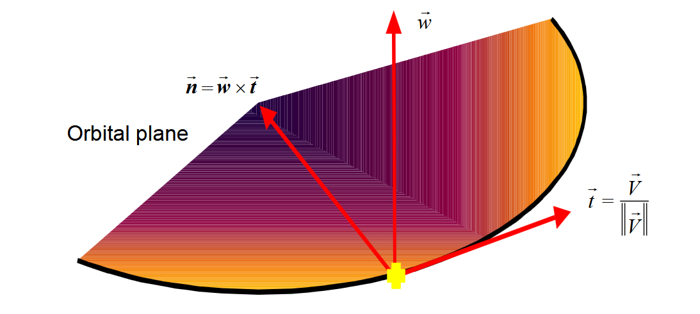

# Local orbital frames

## Summary

Definitions of some local orbital frames.

## Body

### QSW Frame

Q represents the normalized radius, S "second", W the letter omega. QSW can also be referenced to as :
* RTN (Radial, Tangential, Normal)
* RSW (see QSW)
* RIC (Radial, In-track, Cross-track)

* **Origin** : spacecraft gravity center
* $\vec{Q} = \frac{\vec{r}}{\|\vec{r}\|}$ where $\vec{r}$ is the geocentric position
* $\vec{W} = \frac{\vec{h}}{\|\vec{h}\|}$ where $\vec{h}=\vec{r}\times \vec{v}$ is the angular momentum. It is normal to the orbit plan by definition.
* $\vec{S} = \vec{W} \times \vec{Q}$  

### LVLH Frame

### TNW Frame

## See also

## Sources

- CCSDS NAVIGATION DATA — DEFINITIONS AND CONVENTIONS, 2019. §4.3.7
